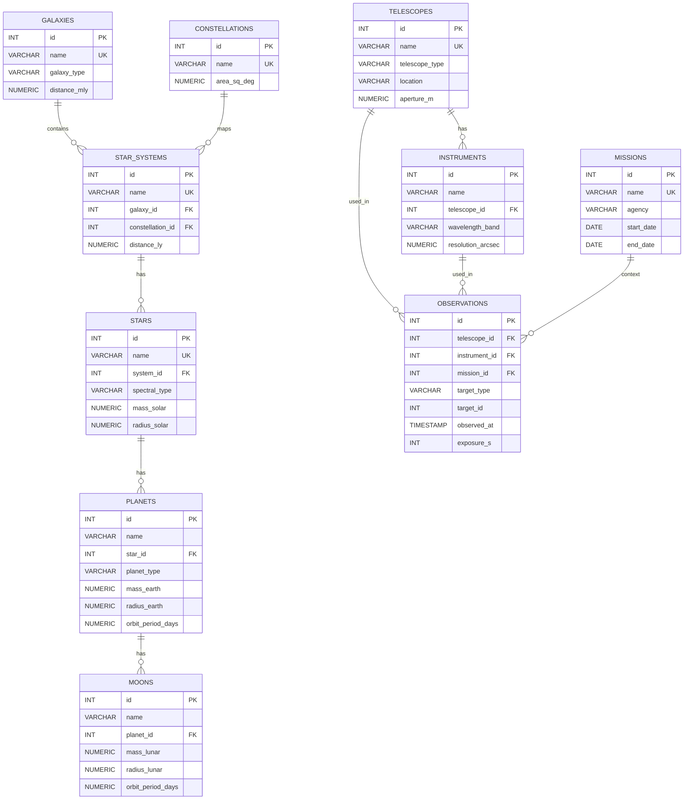
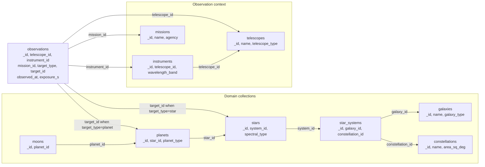
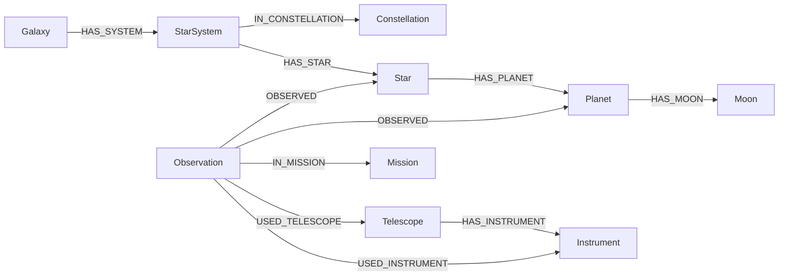

# Diagramy architektury baz danych

## 1) ERD - PostgreSQL

## 2) ERD - MySQL

## 3) Schemat dokumentowy - MongoDB

Wzorzec dokumentu observations (przyklad):

{
\_id: Number,
telescope_id: Number,
instrument_id: Number,
mission_id: Number | null,
target_type: "star" | "planet",
target_id: Number,
observed_at: ISODate,
exposure_s: Number
}

## 4) Schemat dokumentowy - Neo4j (model grafowy)

Minimalny zestaw wlasciwosci:

- Galaxy: id, name, galaxy_type, distance_mly
- Constellation: id, name, area_sq_deg
- StarSystem: id, name, distance_ly
- Star: id, name, spectral_type, mass_solar, radius_solar
- Planet: id, name, planet_type, mass_earth, radius_earth, orbit_period_days
- Moon: id, name, mass_lunar, radius_lunar
- Telescope: id, name, telescope_type, location, aperture_m
- Instrument: id, name, wavelength_band, resolution_arcsec
- Mission: id, name, agency, start_date
- Observation: id, target_type, target_id, observed_at, exposure_s
